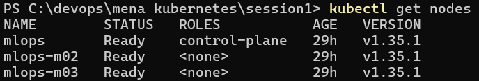
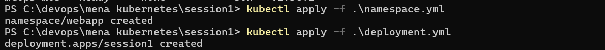
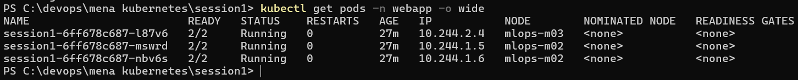
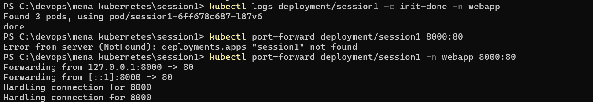
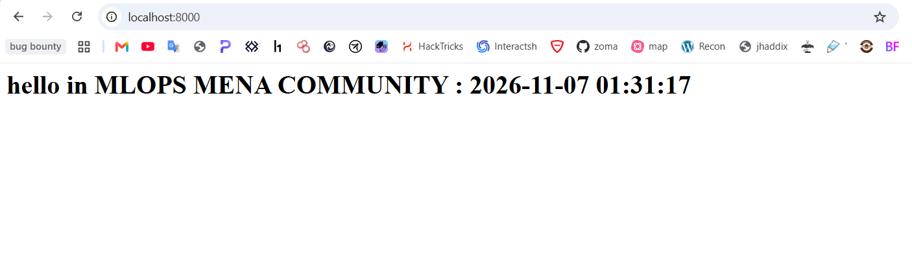
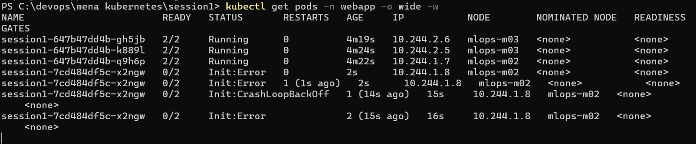
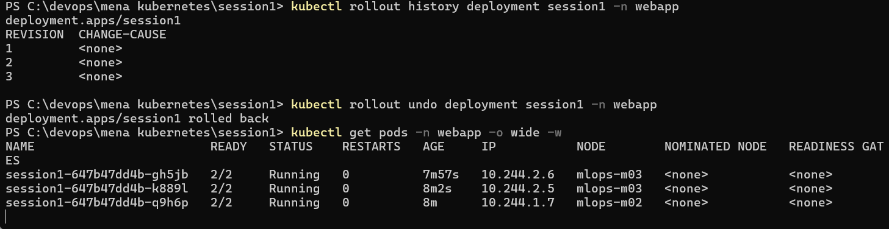

# Task 1 — Multi-container Pods (Init Container & Sidecar)

nginx page that serves the time, refreshed every 1 seconds by a sidecar, with an init container that that just says `done`

```
hello in MLOPS MENA COMMUNITY : 2026-11-05 19:34:12
```

## infrastructure

i used minikube: 1 control plane + 2 workers.

| Course (minikube)       | Mine (KubeLabs) |
| ----------------------- | --------------- |
| `mlops` (control plane) | `cplane-01`     |
| `mlpos-m02` (worker)    | `node-01`       |
| `mlops-m03` (worker)    | `node-02`       |

## Files

| File              | Purpose                           |
| ----------------- | --------------------------------- |
| `namespace.yaml`  | Namespace `webapp`                |
| `deployment.yaml` | Deployment `session1`: 3 replicas |

## Pods

| Container      | Type    | Image          | Job |
| -------------- | ------- | -------------- | --- |
| `init-done`    | init    | `busybox:1.36` |
| `nginx`        | main    | `nginx:1.27`   |
| `time-updater` | sidecar | `busybox:1.36` |

## Task solution methodologies

1. we can use a shared volume (empty dir) ,so that the side car can write in it contiously
2. (used) we can run the containers of each pod in a shared linux namespace so they can see each other `PID` and grantee the side can contianer the `SYS_PTRACE` so that it can open the `/proc/PID/root/usr/share/nginx/html` folder

## 1. Infrastructure creation

```shell
minikube start -p mlops --driver=docker

kubectl get nodes
```



## 2. Deploy

```shell
kubectl apply -f namespace.yaml
kubectl apply -f deployment.yaml
```



```
kubectl get pods -n webapp -o wide
```



3 Pods `2/2 Running`: two on `mlops-m02`, one on `mlops-m03`.
=> The running state indicates that the `init container` has finished and now the main and the side are working

![]

## 3. Init ouput , Hosted web page

```shell
kubectl logs deployment/session1 -c init-done -n webapp
kubectl port-forward deployment/session1 -n webapp 8000:80
```





**untill here we have ran all sucuessfully**

## 4. Break the init container

we will change the state of exit of the init contianer to `exit 1`

```yaml
command: ["sh", "-c", "echo 'init failed'; exit 1"]
```

```shell
kubectl apply -f deployment.yaml          # deployment.apps/web-deployment configured
kubectl get pods -n webapp -w
```



this is considerd an update to the deployemnt that why we can see that the hash of the new replica is different from the old one

## 5. Fixing

since the deployment enable the rollback to the previous version in case we had a bad update

```
kubectl rollout history deployment session1 -n webapp
kubectl rollout undo deployment session1 -n webapp
```


